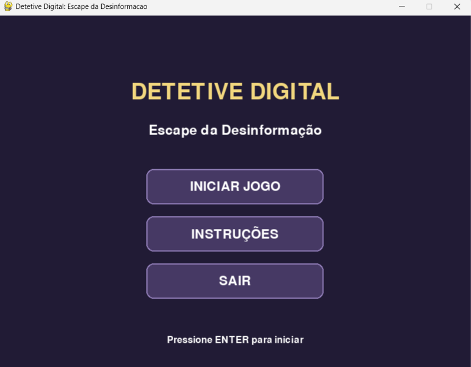
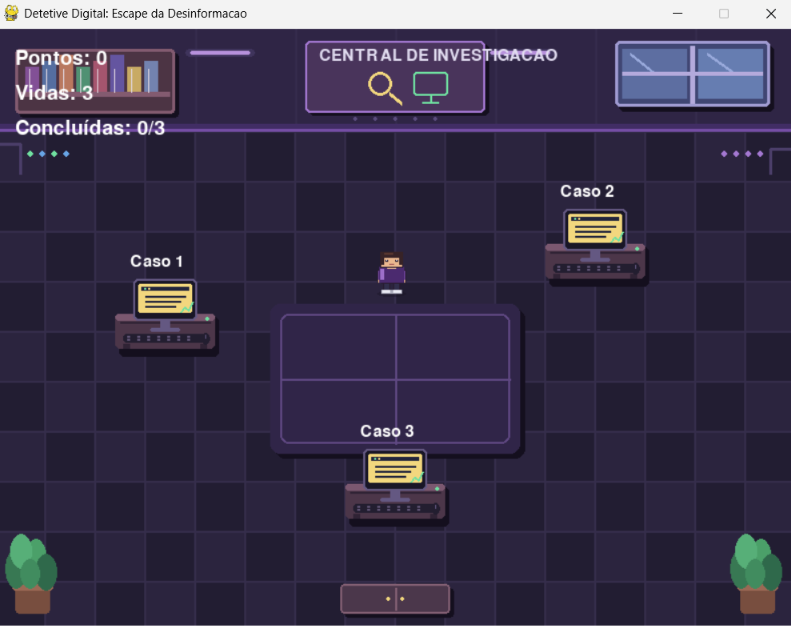

# 🕵️ Detetive Digital: Escape da Desinformação

Projeto final da disciplina de Introdução a Algoritmos/Programação, desenvolvido com Python e Pygame.

<p align="center">
  
</p>

<p align="center">
  
</p>

O jogo tem como proposta estimular o pensamento crítico e a análise de informações por meio de investigações sobre notícias reais, manipuladas e conteúdos criados por Inteligência Artificial.

## Integrante

- Giovanna Brito Silva Ribeiro

## Estrutura do projeto

- `main.py`: ponto de entrada da aplicação.
- `src/`: código-fonte principal do jogo, incluindo configurações, funções, gerenciamento de dados, sprites e execução da partida.
- `assets/`: imagens, fontes e sons utilizados no jogo.
- `data/`: diretório destinado ao armazenamento de dados do jogo.
- `tests/`: testes automatizados das funções de lógica.
- `docs/`: documentação do projeto, incluindo a proposta inicial.

## Descrição do jogo

Detetive Digital: Escape da Desinformação é um jogo educativo em 2D no qual o jogador assume o papel de um investigador digital. Por meio da exploração de um cenário e da interação com computadores, o jogador recebe notícias e precisa analisar as informações apresentadas.

Cada conteúdo deve ser classificado em uma das seguintes categorias:

- **Real:** informação autêntica, respaldada por evidências.
- **Manipulada:** conteúdo que apresenta alterações ou distorções de informações.
- **Criada por IA:** conteúdo produzido por ferramentas de Inteligência Artificial.

Após cada investigação, o jogador recebe o resultado da classificação e uma explicação sobre o conteúdo analisado.

## Objetivo do jogador

O objetivo é investigar os conteúdos apresentados, identificar corretamente sua classificação e concluir as investigações.

O jogador deve utilizar as informações disponíveis e desenvolver uma postura crítica diante de conteúdos que circulam no ambiente digital.

## Regras do jogo

- O jogador controla um personagem que pode se movimentar pelo cenário.
- Para iniciar uma investigação, é necessário se aproximar de um computador e pressionar a tecla `E`.
- Cada notícia apresenta três possibilidades de classificação.
- Uma resposta correta aumenta a pontuação.
- Uma resposta incorreta reduz uma vida.
- O jogador inicia a partida com três vidas.
- Após responder, o jogador recebe uma explicação sobre a classificação.
- O jogo possui condições de vitória e derrota, de acordo com o desempenho do jogador.

## Controles

| Tecla | Ação |
|---|---|
| `W` | Mover para cima |
| `S` | Mover para baixo |
| `A` | Mover para a esquerda |
| `D` | Mover para a direita |
| `E` | Interagir com o computador e abrir ou fechar a investigação |
| `1` | Classificar como Real |
| `2` | Classificar como Manipulada |
| `3` | Classificar como Criada por IA |
| Fechar janela | Sair do jogo |

## Tecnologias utilizadas

- Python
- Pygame
- Unittest
- Git e GitHub

## Como executar o projeto

### 1. Clonar o repositório

```bash
git clone https://github.com/giovanna-brito/detetive-digital-escape-da-desinformacao.git
```

### 2. Entrar na pasta do projeto

```bash
cd detetive-digital-escape-da-desinformacao
```

### 3. Instalar as dependências

```bash
pip install -r requirements.txt
```

### 4. Executar o jogo

```bash
python main.py
```

## Como executar os testes

Para executar os testes automatizados das funções de lógica:

```bash
python -m unittest discover -s tests -p "test_logica.py" -v
```

## Documentação

A documentação do projeto, incluindo a proposta inicial, está disponível na pasta `docs/`.

## Considerações finais

O projeto foi desenvolvido utilizando programação modular, com separação entre configurações, funções, dados e execução do jogo.

As notícias e suas respectivas classificações são previamente cadastradas. O jogo busca promover o pensamento crítico e a conscientização sobre a importância de verificar informações antes de compartilhá-las.
